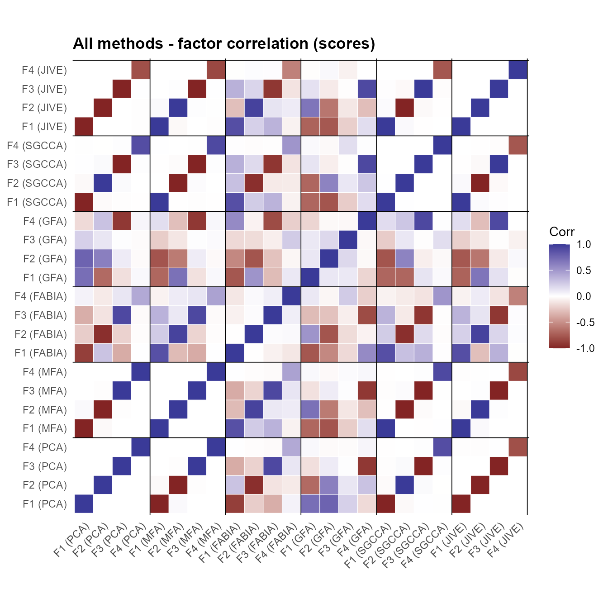
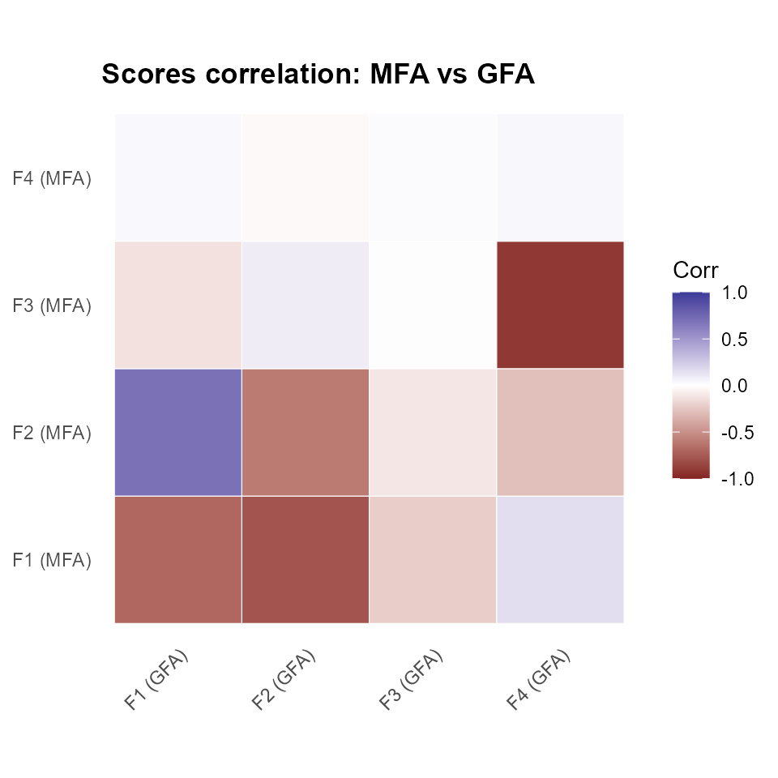
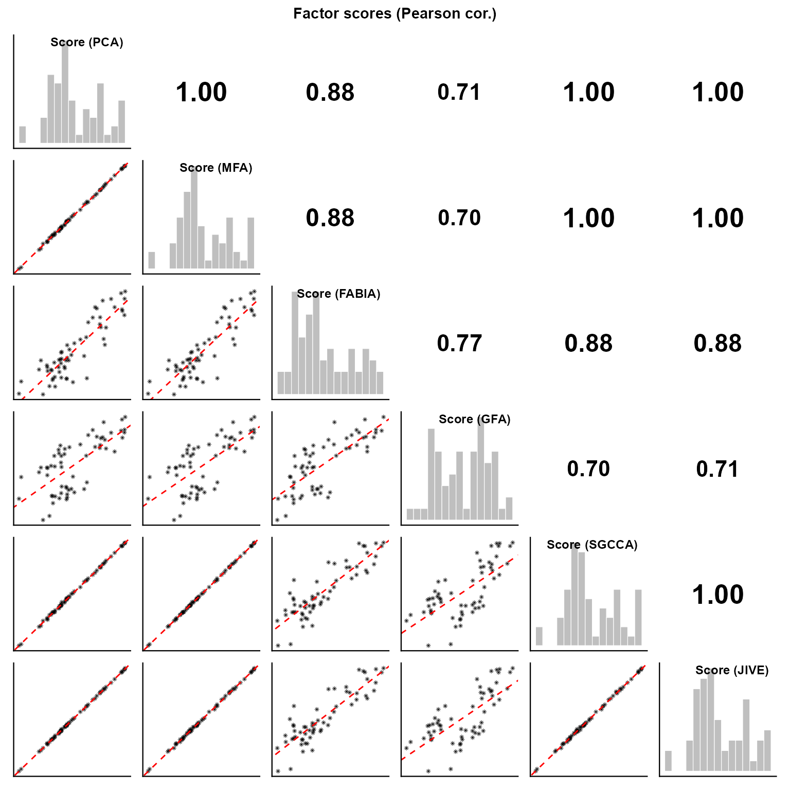
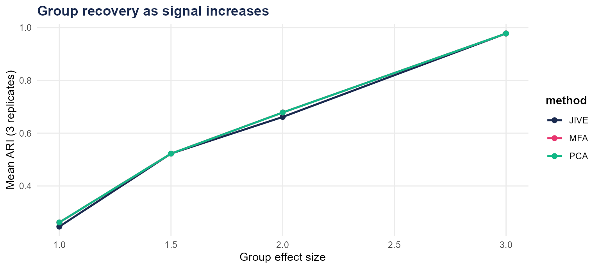

# Benchmarking factor methods

When several methods are run on the same data, two questions follow:
**do they find the same factors?** and, when the truth is known, **which
recovers it best?** factomics answers both.

``` r

library(factomics)
sim <- simulate_multiomics(n_samples = 60, seed = 1)
res <- run_factor_pipeline(
  sim$data, methods = c("PCA", "MFA", "FABIA", "GFA", "SGCCA", "JIVE"),
  k = 4, verbose = FALSE)
```

## Do the methods agree?

Factor order and sign are arbitrary, so factors are first matched
between each pair of methods with the Hungarian algorithm on the
absolute score correlations. The summary reports how well the matched
factors agree:

``` r

bm <- benchmark_factor_methods(res)
knitr::kable(bm$summary_table_scores[, c("pair", "k_matched_scores",
                                         "mean_abs_corr_scores",
                                         "max_abs_corr_scores")],
             digits = 2)
```

| pair           | k_matched_scores | mean_abs_corr_scores | max_abs_corr_scores |
|:---------------|-----------------:|---------------------:|--------------------:|
| PCA vs MFA     |                4 |                 1.00 |                1.00 |
| PCA vs FABIA   |                4 |                 0.79 |                0.95 |
| PCA vs GFA     |                4 |                 0.59 |                0.91 |
| PCA vs SGCCA   |                4 |                 0.97 |                1.00 |
| PCA vs JIVE    |                4 |                 0.95 |                1.00 |
| MFA vs FABIA   |                4 |                 0.80 |                0.95 |
| MFA vs GFA     |                4 |                 0.60 |                0.92 |
| MFA vs SGCCA   |                4 |                 0.98 |                1.00 |
| MFA vs JIVE    |                4 |                 0.96 |                1.00 |
| FABIA vs GFA   |                4 |                 0.65 |                0.82 |
| FABIA vs SGCCA |                4 |                 0.82 |                0.95 |
| FABIA vs JIVE  |                4 |                 0.83 |                0.95 |
| GFA vs SGCCA   |                4 |                 0.64 |                0.92 |
| GFA vs JIVE    |                4 |                 0.60 |                0.91 |
| SGCCA vs JIVE  |                4 |                 0.94 |                1.00 |

The same is done for loadings, per view:

``` r

head(bm$summary_table_loadings[, c("pair", "dataset",
                                   "mean_abs_corr_loadings")])
#>           pair       dataset mean_abs_corr_loadings
#> 1   PCA vs MFA transcriptome              0.9985341
#> 2   PCA vs MFA    metabolome              0.9985559
#> 3   PCA vs MFA    microbiome              0.9991558
#> 4 PCA vs FABIA transcriptome              0.7903666
#> 5 PCA vs FABIA    metabolome              0.7616376
#> 6 PCA vs FABIA    microbiome              0.8272434
```

All factors of all methods in one correlation heatmap:

``` r

bm$all_scores_heatmap
```



Pairwise heatmaps and scatter plots of matched factors are also
returned:

``` r

bm$pair_heatmaps_scores[["MFA|GFA"]]
```



``` r

bm$pairs_scores_by_factor[["F1"]]
```



## Which method recovers the truth?

With simulated data the true factors and signal features are known.

**Factor recovery**: the best absolute correlation of each true factor
with any fitted factor.

``` r

recovery <- sapply(names(res), function(m)
  apply(abs(cor(sim$truth$Z, res[[m]]$scores)), 1, max))
round(recovery, 2)
#>      PCA  MFA FABIA  GFA SGCCA JIVE
#> LF1 0.95 0.94  0.98 0.83  0.94 0.95
#> LF2 0.96 0.96  1.00 0.76  0.96 0.96
#> LF3 0.90 0.90  1.00 0.80  0.91 0.90
```

**Feature recovery**: give
[`benchmark_factor_methods()`](https://lucp12891.github.io/factomics/reference/benchmark_factor_methods.md)
the true 0/1 feature labels and it reports, per method, the AUC of the
largest absolute loading as a score for “this feature carries signal”.

``` r

bm_truth <- benchmark_factor_methods(
  res, ground_truth_feature = sim$truth$feature_labels)
bm_truth$auc_results
#>    target method       AUC
#> 1 feature    PCA 0.8432460
#> 2 feature    MFA 0.8590427
#> 3 feature  FABIA 0.8793578
#> 4 feature    GFA 0.8581977
#> 5 feature  SGCCA 0.8420337
#> 6 feature   JIVE 0.8427317
```

**Sample groups**: the adjusted Rand index of the clusters found on each
method’s factors.

``` r

cl <- cluster_results(res, k = 2:6)
compare_clusterings(cl, setNames(sim$metadata$group,
                                 sim$metadata$sample))$vs_truth
#>              method       ARI
#> 1               PCA 1.0000000
#> 2               MFA 1.0000000
#> 3             FABIA 0.6330688
#> 4               GFA 1.0000000
#> 5             SGCCA 1.0000000
#> 6              JIVE 1.0000000
#> 7 Concatenated data 1.0000000
```

## Repeating over many simulated data sets

A small benchmark loop, varying the signal strength:

``` r

bench_one <- function(effect, seed) {
  s <- simulate_multiomics(n_samples = 45, effect = effect, seed = seed)
  r <- run_factor_pipeline(s$data, methods = c("PCA", "MFA", "JIVE"), k = 3,
                           verbose = FALSE)
  cl <- cluster_results(r, k = 3, include_data = FALSE)
  out <- compare_clusterings(cl, setNames(s$metadata$group,
                                          s$metadata$sample))$vs_truth
  out$effect <- effect
  out
}
grid <- do.call(rbind, lapply(c(1, 1.5, 2, 3), function(e)
  do.call(rbind, lapply(1:3, function(sd) bench_one(e, sd)))))
agg <- aggregate(ARI ~ method + effect, grid, mean)
```

``` r

library(ggplot2)
ggplot(agg, aes(effect, ARI, colour = method)) +
  geom_line(linewidth = 0.9) + geom_point(size = 2) +
  scale_colour_manual(values = factomics_palette(3)) +
  labs(x = "Group effect size", y = "Mean ARI (3 replicates)",
       title = "Group recovery as signal increases") +
  theme_factomics()
```


