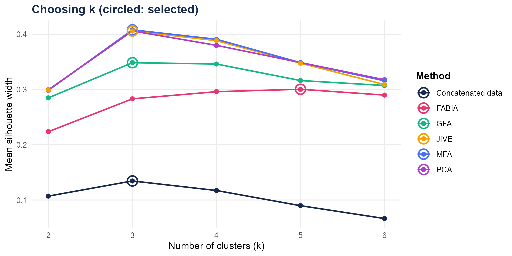
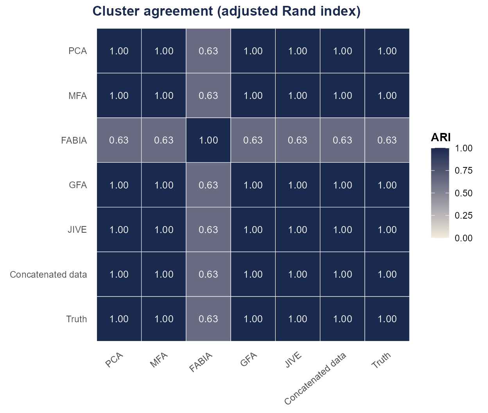
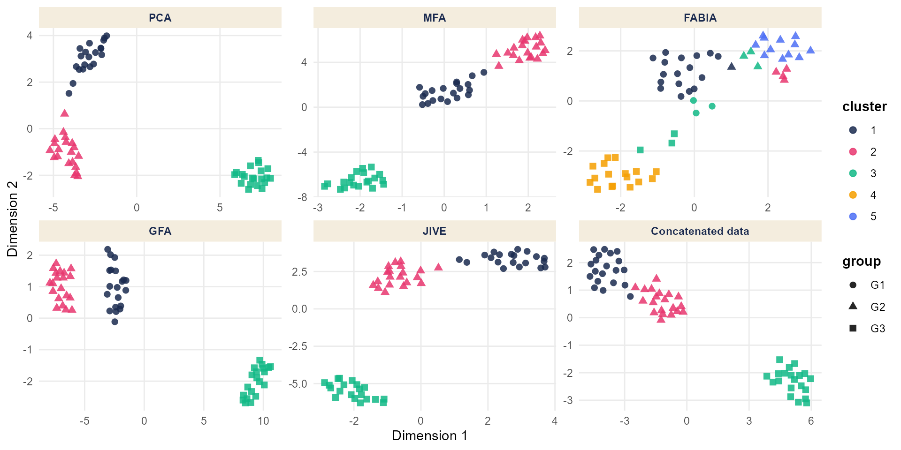

# Clustering samples on factors

Factor models compress many features into a few factors; clustering on
those factors is often more robust than clustering on the raw features,
because noise and view size imbalance are reduced.

``` r

library(factomics)
sim <- simulate_multiomics(n_samples = 60, n_groups = 3, seed = 1)
res <- run_factor_pipeline(sim$data,
                           methods = c("PCA", "MFA", "FABIA", "GFA", "JIVE"),
                           k = 4, verbose = FALSE)
truth <- setNames(sim$metadata$group, sim$metadata$sample)
```

## One matrix

[`cluster_samples()`](https://lucp12891.github.io/factomics/reference/cluster_samples.md)
clusters any samples x features matrix with k-means, hierarchical
clustering (Ward) or PAM. Give several values of `k` and the one with
the highest mean silhouette width is kept:

``` r

cl_mfa <- cluster_samples(res$MFA$scores, method = "hclust", k = 2:6)
cl_mfa
#> <factomics_clustering> hclust, k = 3, mean silhouette = 0.399
#> cluster
#>  1  2  3 
#> 22 20 18
cl_mfa$by_k
#>   k silhouette
#> 1 2  0.2858014
#> 2 3  0.3994010
#> 3 4  0.3275619
#> 4 5  0.3061201
#> 5 6  0.2796139
```

By default the factor scores are **not** re-standardised, so each factor
keeps its own variance and weak or noise factors weigh less. Use
`scale = TRUE` to give every factor equal weight.

## Every method at once

``` r

cl <- cluster_results(res, cluster_method = "kmeans", k = 2:6)
cl
#> <factomics_clusters>
#>             method algorithm k silhouette
#>                PCA    kmeans 3      0.406
#>                MFA    kmeans 3      0.408
#>              FABIA    kmeans 5      0.300
#>                GFA    kmeans 3      0.349
#>               JIVE    kmeans 3      0.406
#>  Concatenated data    kmeans 3      0.134
```

``` r

plot_clusters(cl, "silhouette")
```



## Agreement between methods and with known labels

``` r

cmp <- compare_clusterings(cl, truth = truth)
round(cmp$agreement, 2)
#>                    PCA  MFA FABIA  GFA JIVE Concatenated data
#> PCA               1.00 1.00  0.63 1.00 1.00              1.00
#> MFA               1.00 1.00  0.63 1.00 1.00              1.00
#> FABIA             0.63 0.63  1.00 0.63 0.63              0.63
#> GFA               1.00 1.00  0.63 1.00 1.00              1.00
#> JIVE              1.00 1.00  0.63 1.00 1.00              1.00
#> Concatenated data 1.00 1.00  0.63 1.00 1.00              1.00
cmp$vs_truth
#>              method       ARI
#> 1               PCA 1.0000000
#> 2               MFA 1.0000000
#> 3             FABIA 0.6330688
#> 4               GFA 1.0000000
#> 5              JIVE 1.0000000
#> 6 Concatenated data 1.0000000
```

``` r

plot_clusters(cl, "agreement", truth = truth)
```



## Clusters in an embedding

Pass the clustering to
[`plot_embedding()`](https://lucp12891.github.io/factomics/reference/plot_embedding.md)
to colour each method’s embedding by its own clusters:

``` r

emb <- embed_results(res, type = "umap")
plot_embedding(emb, clusters = cl, shape_by = "group",
               metadata = sim$metadata)
```



## Comparing algorithms

``` r

algos <- c("kmeans", "hclust", "pam")
ari <- sapply(algos, function(a) {
  cl_a <- cluster_results(res, cluster_method = a, k = 2:6)
  setNames(compare_clusterings(cl_a, truth)$vs_truth$ARI,
           cl_a$summary$method)
})
round(ari, 2)
#>                   kmeans hclust  pam
#> PCA                 1.00   0.90 0.95
#> MFA                 1.00   0.90 0.95
#> FABIA               0.63   0.65 0.74
#> GFA                 1.00   1.00 0.95
#> JIVE                1.00   0.80 0.95
#> Concatenated data   1.00   0.95 0.90
```
