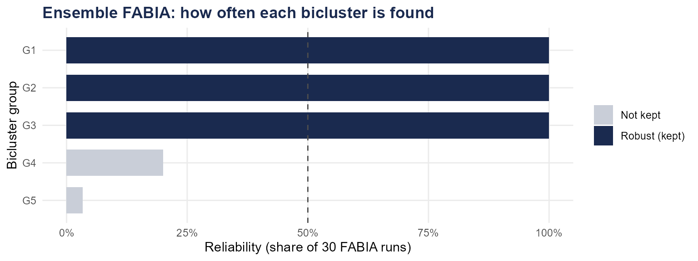
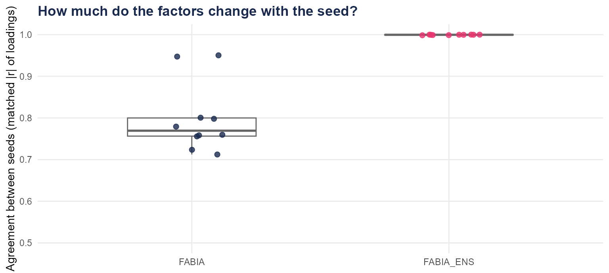
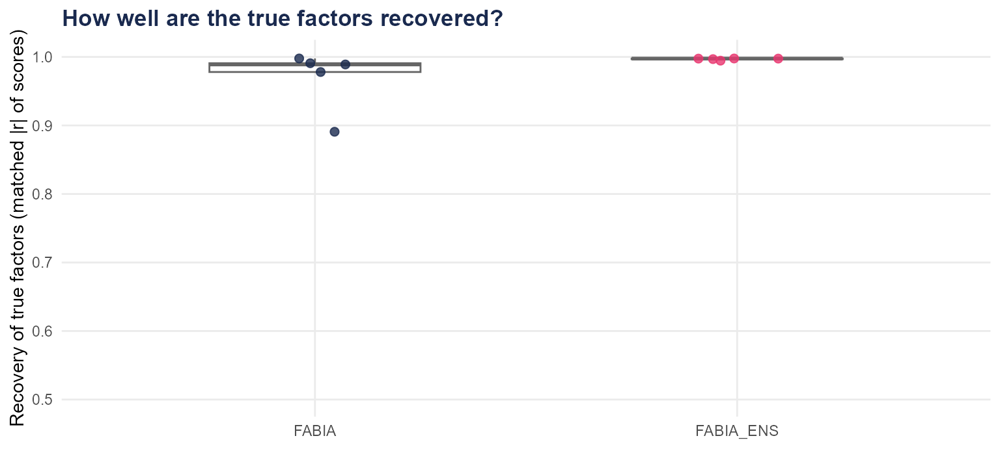

# FABIA versus ensemble FABIA

FABIA starts from random values, so two runs on the same data can give
different biclusters. Which ones should you trust? The **ensemble**
approach (Khamiakova, Kaiser and Shkedy, Chapter 10 of *Applied
Biclustering Methods for Big and High-Dimensional Data Using R*, Kasim
et al. 2016) answers this by running the algorithm many times and
keeping only the biclusters that come back again and again. factomics
applies it to FABIA as the method `"FABIA_ENS"`.

## How the ensemble works

1.  Run FABIA `runs` times, each with a different seed and, optionally,
    on a random subsample of the samples (`sample_fraction`).
2.  Turn every factor of every run into a bicluster (its features and
    samples), with
    [`fabia::extractBic()`](https://rdrr.io/pkg/fabia/man/extractBic.html).
3.  Compute the Jaccard similarity between all biclusters: the share of
    feature-sample combinations they have in common.
4.  Group the biclusters by complete-linkage hierarchical clustering,
    cutting the tree at a similarity of 0.5, so biclusters in a group
    share at least half of their elements.
5.  Give each group a **reliability**: the share of runs in which it was
    found. Groups found in at least half of the runs (`min_reliability`)
    are robust.
6.  Form the robust bicluster from the features and samples present in
    at least half of the group’s biclusters (`membership`; 1 gives the
    core intersection, a small value the union “super-bicluster”).

So that ensemble FABIA can be used like any other factomics method, each
robust group also becomes a factor, whose loadings and scores are the
averages over the group’s members (after aligning their signs).

``` r

library(factomics)
sim <- simulate_multiomics(n_samples = 60, seed = 1)   # 3 true factors

res <- run_factor_pipeline(sim$data, methods = c("FABIA", "FABIA_ENS"), k = 4,
                           fabia_ens_control = list(runs = 30),
                           verbose = FALSE)
res
#> <factomics_results>
#>   60 samples, 3 view(s): transcriptome (200), metabolome (80), microbiome (50)
#>   FABIA     4 factors
#>   FABIA_ENS 3 factors
```

We asked for 4 factors. Plain FABIA returns 4, but the ensemble keeps
only the factors it found reliably, which here are the 3 that are really
in the data.

## Which biclusters are robust?

``` r

plot_fabia_ensemble(res)
```



``` r

res$FABIA_ENS$meta$groups
#>   group size n_runs reliability  kept
#> 1     1   30     30  1.00000000  TRUE
#> 2     2   30     30  1.00000000  TRUE
#> 3     3   30     30  1.00000000  TRUE
#> 4     4    6      6  0.20000000 FALSE
#> 5     5    1      1  0.03333333 FALSE
```

Three groups were found in every run. The others turned up only in some
runs: they depend on the starting values and a single FABIA run might
report one of them as a real bicluster.

The robust biclusters themselves, with their features and samples:

``` r

b <- res$FABIA_ENS$meta$biclusters
sapply(b, function(x) c(features = length(x$features),
                        samples = length(x$samples),
                        reliability = x$reliability))
#>             F1 F2 F3
#> features    56 32 49
#> samples     21 18 23
#> reliability  1  1  1
head(b$F1$features)
#> [1] "transcriptome::gene_001" "transcriptome::gene_002"
#> [3] "transcriptome::gene_015" "transcriptome::gene_035"
#> [5] "transcriptome::gene_043" "transcriptome::gene_049"
```

How many of the robust features are true signal features in the
simulation?

``` r

truth <- sim$truth$feature_labels
robust <- unique(unlist(lapply(b, `[[`, "features")))
table(robust = names(truth) %in% robust, true_signal = truth)
#>        true_signal
#> robust    0   1
#>   FALSE 167  27
#>   TRUE    0 136
```

Every feature in a robust bicluster is a true signal feature: the
ensemble adds no noise features.

The tree of all biclusters from all runs, as in the book (each robust
group joins at a low height):

``` r

plot(res$FABIA_ENS$meta$tree, labels = FALSE, hang = -1,
     main = "Biclusters from 30 FABIA runs", xlab = "",
     sub = "Complete linkage on 1 - Jaccard")
abline(h = 0.5, lty = 2, col = "#E8366F")
```


## Comparing FABIA and ensemble FABIA across seeds

[`factor_stability()`](https://lucp12891.github.io/factomics/reference/factor_stability.md)
fits the methods once per seed and checks how much the factors change:
for every pair of seeds the factors are matched and their loadings
correlated. Since the truth is known here, it also reports how well the
true factors are recovered.

``` r

st <- factor_stability(sim$data, methods = c("FABIA", "FABIA_ENS"), k = 4,
                       seeds = 1:5, truth = sim$truth$Z,
                       fabia_ens_control = list(runs = 30))
st
#> <factomics_stability> 5 seeds
#>     method mean_stability min_stability mean_recovery sd_recovery
#>      FABIA          0.798         0.712         0.969     0.04444
#>  FABIA_ENS          0.999         0.998         0.997     0.00132
```

``` r

plot_factor_stability(st)
```



``` r

plot_factor_stability(st, "recovery")
```



A single FABIA run gives clearly different factors depending on the
seed. The ensemble gives practically the same factors whatever the seed,
and recovers the true factors at least as well.

## Parameters and their defaults

| Setting | Default | Meaning |
|----|----|----|
| `k` | 5 | Factors (biclusters) per FABIA run; also the maximum number of robust factors returned |
| `fabia_alpha` | 0.01 | FABIA sparseness of the loadings (larger = sparser) |
| `fabia_cyc` | 1000 | FABIA iterations per run |
| FABIA priors | `spz = 0.5`, `spl = 0.1`, `lap = 1`, `nL = 2` | Fixed, as for plain `"FABIA"` |
| `runs` | 30 | Number of FABIA runs (the book used 100) |
| `sample_fraction` | 1 | Share of samples per run; below 1 = subsampling |
| `thresZ` | 0.5 | Score threshold that turns a FABIA factor into a bicluster ([`fabia::extractBic()`](https://rdrr.io/pkg/fabia/man/extractBic.html)) |
| `thresL` | `NULL` | Loading threshold for the same; `NULL` lets FABIA choose it from `thresZ` |
| `similarity` | 0.5 | Jaccard similarity at which the bicluster tree is cut |
| `min_reliability` | 0.5 | Share of runs a group must be found in to be kept |
| `membership` | 0.5 | Share of a group’s biclusters a feature or sample must be in (1 = core, small = union) |

## How sensitive is the ensemble to its parameters?

We changed one setting at a time from the defaults (with `k = 4`) on
three simulated data sets with three true factors each, and recorded how
many robust factors were returned, how many of the true factors were
found (\|r\| \> 0.8), the recovery of the true scores, and the precision
and recall of the features in the robust biclusters against the true
signal features. Plain FABIA (one run, seed 21, biclusters extracted the
same way) is shown for comparison. The script is
`data-raw/fabia-ensemble-sensitivity.R` in the package source.

``` r

d <- read.csv("fabia-ensemble-sensitivity.csv")
d$setting <- ifelse(d$param == "default", "default",
                    paste(d$param, "=", d$value))
s <- aggregate(cbind(n_factors, true_found, recovery, precision, recall,
                     seconds) ~ method + setting, d, mean,
               na.action = na.pass)
s <- s[order(s$method != "FABIA", s$setting != "default", s$setting), ]
knitr::kable(s, digits = 2, row.names = FALSE,
             col.names = c("Method", "Setting", "Factors", "True found (of 3)",
                           "Recovery", "Precision", "Recall", "Seconds"))
```

| Method | Setting | Factors | True found (of 3) | Recovery | Precision | Recall | Seconds |
|:---|:---|---:|---:|---:|---:|---:|---:|
| FABIA | default | 4.00 | 2.00 | 0.91 | 0.99 | 0.78 | 0.93 |
| FABIA | alpha = 0.05 | 4.00 | 3.00 | 1.00 | 1.00 | 0.80 | 0.52 |
| FABIA | alpha = 0.1 | 4.00 | 3.00 | 1.00 | 1.00 | 0.72 | 0.50 |
| FABIA | k = 3 | 3.00 | 3.00 | 1.00 | 1.00 | 0.74 | 0.42 |
| FABIA | k = 6 | 6.00 | 3.00 | 0.99 | 0.98 | 0.87 | 0.71 |
| FABIA_ENS | default | 3.00 | 3.00 | 1.00 | 1.00 | 0.82 | 22.46 |
| FABIA_ENS | alpha = 0.05 | 3.00 | 3.00 | 1.00 | 1.00 | 0.80 | 15.74 |
| FABIA_ENS | alpha = 0.1 | 3.00 | 3.00 | 1.00 | 1.00 | 0.71 | 14.85 |
| FABIA_ENS | k = 3 | 3.00 | 3.00 | 1.00 | 1.00 | 0.74 | 11.93 |
| FABIA_ENS | k = 6 | 3.00 | 3.00 | 1.00 | 1.00 | 0.88 | 19.02 |
| FABIA_ENS | membership = 0.2 | 3.00 | 3.00 | 1.00 | 1.00 | 0.83 | 8.46 |
| FABIA_ENS | membership = 1 | 3.00 | 3.00 | 1.00 | 1.00 | 0.74 | 8.51 |
| FABIA_ENS | min_reliability = 0.3 | 3.00 | 3.00 | 1.00 | 1.00 | 0.82 | 7.84 |
| FABIA_ENS | min_reliability = 0.8 | 3.00 | 3.00 | 1.00 | 1.00 | 0.82 | 8.05 |
| FABIA_ENS | runs = 10 | 3.00 | 3.00 | 1.00 | 1.00 | 0.82 | 7.40 |
| FABIA_ENS | runs = 100 | 3.00 | 3.00 | 1.00 | 1.00 | 0.82 | 48.96 |
| FABIA_ENS | sample_fraction = 0.6 | 2.67 | 2.67 | 0.91 | 1.00 | 0.73 | 6.16 |
| FABIA_ENS | sample_fraction = 0.8 | 2.67 | 2.67 | 0.90 | 1.00 | 0.70 | 7.31 |
| FABIA_ENS | sample_fraction 0.8 + similarity = 0.3 | 3.00 | 3.00 | 1.00 | 1.00 | 0.81 | 9.74 |
| FABIA_ENS | similarity = 0.3 | 3.00 | 3.00 | 1.00 | 1.00 | 0.82 | 12.63 |
| FABIA_ENS | similarity = 0.7 | 3.00 | 3.00 | 1.00 | 1.00 | 0.82 | 7.45 |
| FABIA_ENS | thresZ = 0.3 | 1.33 | 1.33 | 0.48 | 1.00 | 0.03 | 12.65 |
| FABIA_ENS | thresZ = 0.8 | 3.33 | 3.00 | 1.00 | 0.99 | 0.91 | 15.93 |

What this shows:

- **Plain FABIA** always returns `k` factors, so with `k = 4` or `k = 6`
  it reports one to three factors that are not in the data, and with the
  default settings it missed all three true factors on one data set
  (below). The ensemble returned exactly the three true factors in every
  one of these cases.
- **`runs`, `similarity`, `min_reliability`**: no effect between 10 and
  100 runs, similarity 0.3 to 0.7 and reliability 0.3 to 0.8. The robust
  biclusters were found in (nearly) every run, so the result is not on a
  knife edge. 30 runs is a safe default; more runs only cost time.
- **`k`**: asking for more factors than exist (`k = 6`) is safe, the
  extra ones are not reproducible and are dropped. Asking for too few
  loses factors.
- **`membership`** trades recall for compactness: 0.2 (close to the
  union) keeps more true features, 1 (the core) fewer; precision stays
  at 1.
- **`alpha`**: larger values give sparser, smaller biclusters (lower
  recall).
- **`thresZ`** matters most. With `thresZ = 0.3` FABIA’s automatic
  loading threshold becomes so strict that biclusters keep only a
  handful of features and most factors are lost. `thresZ = 0.8` gives
  larger biclusters (higher recall) but occasionally an extra small
  bicluster. Keep it between 0.5 and 0.8.
- **`sample_fraction` \< 1** (subsampling) on one data set split a true
  bicluster into two groups, each below 50% reliability, so it was
  dropped. When subsampling, lower `similarity` to about 0.3, which
  brought it back.

Results per data set for the defaults:

``` r

knitr::kable(d[d$param == "default", c("dataset", "method", "n_factors",
                                        "true_found", "recovery", "precision",
                                        "recall")],
             digits = 3, row.names = FALSE)
```

| dataset | method    | n_factors | true_found | recovery | precision | recall |
|--------:|:----------|----------:|-----------:|---------:|----------:|-------:|
|       1 | FABIA     |         4 |          3 |    0.991 |     0.993 |  0.822 |
|       1 | FABIA_ENS |         3 |          3 |    0.997 |     1.000 |  0.834 |
|       2 | FABIA     |         4 |          3 |    0.997 |     1.000 |  0.805 |
|       2 | FABIA_ENS |         3 |          3 |    0.998 |     1.000 |  0.799 |
|       3 | FABIA     |         4 |          0 |    0.727 |     0.991 |  0.716 |
|       3 | FABIA_ENS |         3 |          3 |    0.997 |     1.000 |  0.827 |

## Tuning

All settings are in
[`fabia_ensemble_control()`](https://lucp12891.github.io/factomics/reference/fabia_ensemble_control.md),
passed as `fabia_ens_control = list(...)` in
[`run_factor_pipeline()`](https://lucp12891.github.io/factomics/reference/run_factor_pipeline.md),
or used directly with the shortcut
[`fabia_ensemble()`](https://lucp12891.github.io/factomics/reference/fabia_ensemble.md):

``` r

fit <- fabia_ensemble(sim$data, k = 5, alpha = 0.01, cyc = 1000,
                      control = fabia_ensemble_control(
                        runs = 100,            # the book used 100 seeds
                        sample_fraction = 0.8, # also robust to the samples
                        similarity = 0.3,      # lower cut when subsampling
                        min_reliability = 0.5, # found in >= half the runs
                        membership = 0.5))     # majority robust bicluster
```

- More `runs` give more precise reliabilities; it costs one FABIA fit
  per run.
- `sample_fraction < 1` also makes the biclusters robust to which
  samples were used, a form of subsampling as described in the book.
  Combine it with `similarity = 0.3` (see the sensitivity results
  above).
- If no group reaches `min_reliability`, factomics stops with a message
  giving the best reliability it found; lower `min_reliability` or
  `similarity`.
- `alpha` (sparseness) and `k` are FABIA’s own settings and are the same
  for every run.
