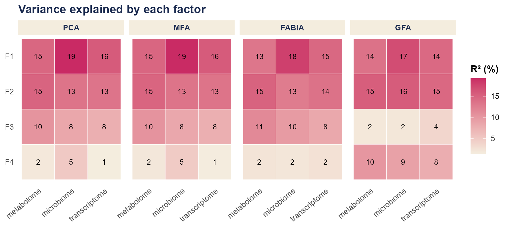
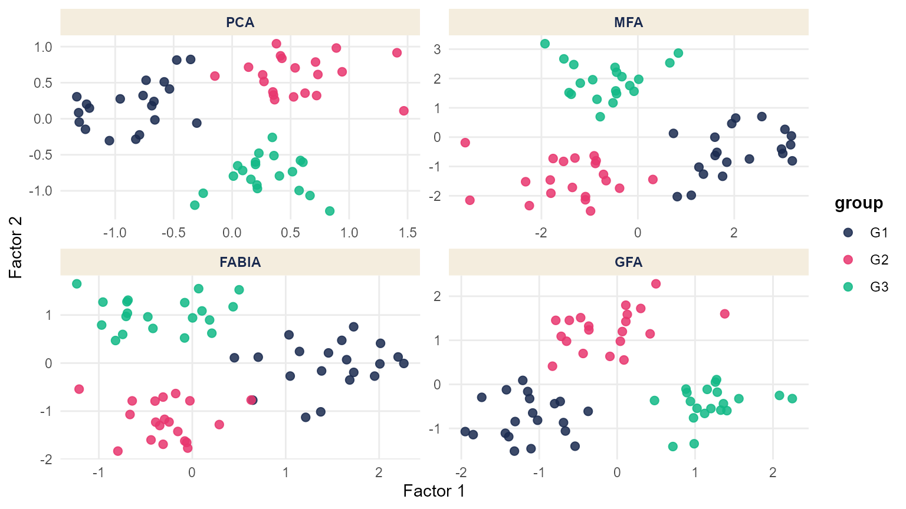
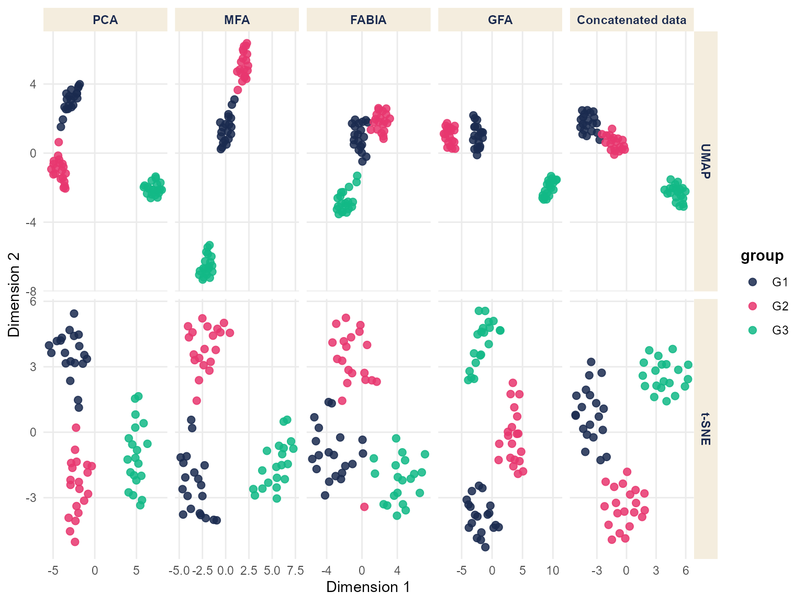
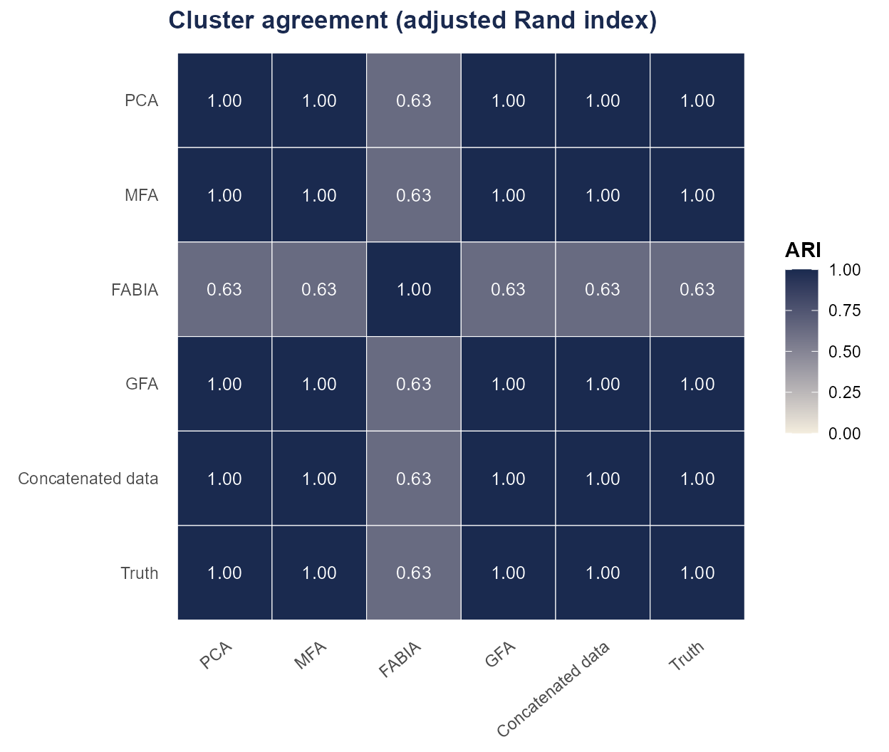
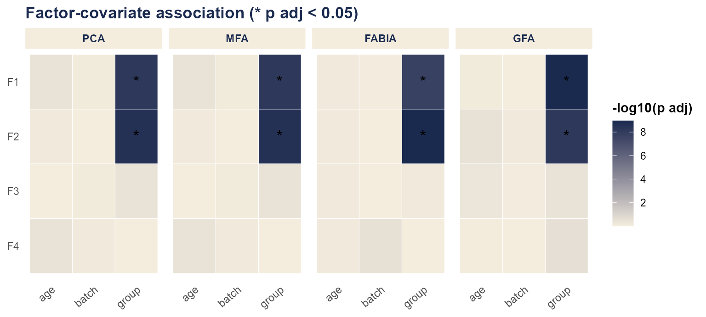
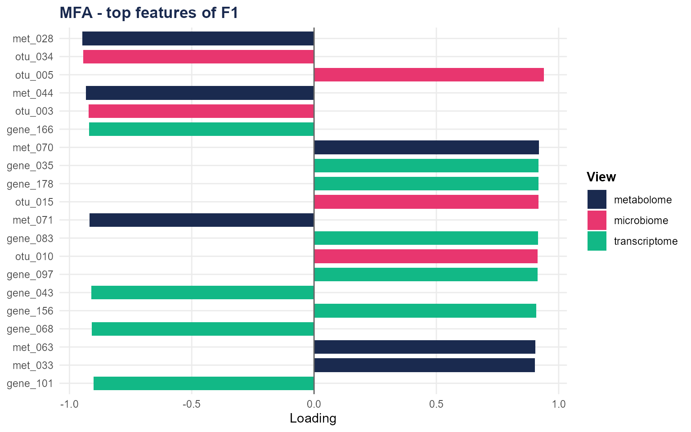
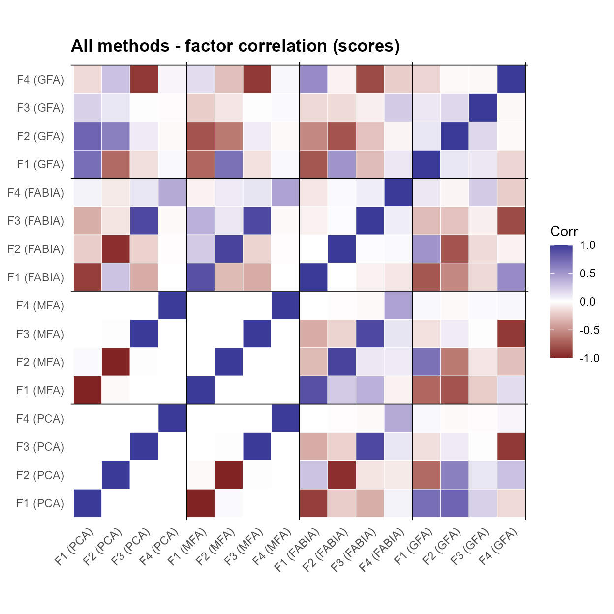

# Get started with factomics

This page walks through a complete multi-omics factor analysis with
**factomics**: fit several factor methods, look at the factors in
low-dimensional embeddings, cluster the samples, check which method
agrees with which, and find out what each factor means.

``` r

library(factomics)
```

## 1. Data

factomics takes a **named list of numeric matrices, features in rows and
samples in columns**, one matrix per omics layer (“view”). All views
must share the same sample names. Here we simulate three views measured
on 60 samples from three groups, with a known set of latent factors:

``` r

sim <- simulate_multiomics(n_samples = 60, n_groups = 3, seed = 1)
lapply(sim$data, dim)
#> $transcriptome
#> [1] 200  60
#> 
#> $metabolome
#> [1] 80 60
#> 
#> $microbiome
#> [1] 50 60
head(sim$metadata)
#>   sample group batch age
#> 1   S001    G1    B1  37
#> 2   S002    G2    B2  54
#> 3   S003    G3    B1  50
#> 4   S004    G1    B2  63
#> 5   S005    G2    B1  34
#> 6   S006    G3    B2  51
```

See the [Using your own
data](https://lucp12891.github.io/factomics/articles/own-data.html)
article for reading your own files.

## 2. Fit factor models

[`run_factor_pipeline()`](https://lucp12891.github.io/factomics/reference/run_factor_pipeline.md)
runs any set of methods and returns them in one format.
[`list_factor_methods()`](https://lucp12891.github.io/factomics/reference/list_factor_methods.md)
shows what is available on your machine:

``` r

list_factor_methods()[, c("method", "package", "installed")]
#>      method    package installed
#> 1       PCA      stats      TRUE
#> 2       MFA FactoMineR      TRUE
#> 3     FABIA      fabia      TRUE
#> 4 FABIA_ENS      fabia      TRUE
#> 5       GFA        GFA      TRUE
#> 6      MOFA      MOFA2      TRUE
#> 7     SGCCA   mixOmics      TRUE
#> 8      JIVE     r.jive      TRUE
#> 9     RABFA  factomics      TRUE
```

``` r

res <- run_factor_pipeline(
  sim$data,
  methods = c("PCA", "MFA", "FABIA", "GFA"),
  k       = 4,
  verbose = FALSE
)
res
#> <factomics_results>
#>   60 samples, 3 view(s): transcriptome (200), metabolome (80), microbiome (50)
#>   PCA       4 factors
#>   MFA       4 factors
#>   FABIA     4 factors
#>   GFA       4 factors
```

Every method has the same three slots: `scores` (samples x factors),
`loadings` (features x factors, named `view::feature`) and `meta`:

``` r

head(res$MFA$scores, 3)
#>              F1         F2           F3         F4
#> S001  0.8180284 -2.0287189 -0.706567378  1.1308431
#> S002 -0.8647655 -0.8026163  2.469756281 -0.4160932
#> S003 -1.3819616  1.4615157  0.004669615 -0.8113732
head(res$GFA$loadings, 3)
#>                                  F1         F2          F3          F4
#> transcriptome::gene_001  0.43013967  0.2782374 -0.06094158 -0.25114472
#> transcriptome::gene_002  0.48068709  0.3678413 -0.22494974 -0.30241875
#> transcriptome::gene_003 -0.05670652 -0.1134287  0.06211398 -0.02830305
```

## 3. Attach metadata

``` r

res <- attach_scores_metadata(res, sim$metadata, sample_col = "sample")
head(res$MFA$scores_with_meta[, c("sample", "F1", "F2", "group")], 3)
#>   sample         F1         F2 group
#> 1   S001  0.8180284 -2.0287189    G1
#> 2   S002 -0.8647655 -0.8026163    G2
#> 3   S003 -1.3819616  1.4615157    G3
```

## 4. How much does each factor explain?

[`variance_explained()`](https://lucp12891.github.io/factomics/reference/variance_explained.md)
regresses each view on each method’s factors, so every method is
measured on the same R^2 scale:

``` r

plot_variance_explained(res)
```



## 5. Look at the factor space

Plot two factors directly, or embed the full factor space with PCA, UMAP
or t-SNE. The concatenated input data are embedded too, as a baseline:

``` r

plot_factor_scores(res, metadata = sim$metadata, color_by = "group")
```



``` r

emb <- embed_results(res, type = c("umap", "tsne"))
plot_embedding(emb, metadata = sim$metadata, color_by = "group")
```



## 6. Cluster the samples

[`cluster_results()`](https://lucp12891.github.io/factomics/reference/cluster_results.md)
clusters the samples on each method’s factors and picks the number of
clusters by the mean silhouette width:

``` r

cl <- cluster_results(res, cluster_method = "kmeans", k = 2:6)
cl
#> <factomics_clusters>
#>             method algorithm k silhouette
#>                PCA    kmeans 3      0.406
#>                MFA    kmeans 3      0.408
#>              FABIA    kmeans 5      0.300
#>                GFA    kmeans 3      0.349
#>  Concatenated data    kmeans 3      0.134
```

Because we know the true groups here, we can score each clustering with
the adjusted Rand index (1 = perfect):

``` r

truth <- setNames(sim$metadata$group, sim$metadata$sample)
compare_clusterings(cl, truth)$vs_truth
#>              method       ARI
#> 1               PCA 1.0000000
#> 2               MFA 1.0000000
#> 3             FABIA 0.6330688
#> 4               GFA 1.0000000
#> 5 Concatenated data 1.0000000
```

``` r

plot_clusters(cl, "agreement", truth = truth)
```



## 7. Interpret the factors

Which factors track the sample covariates?

``` r

plot_factor_associations(res, sim$metadata)
```



Which features drive a factor?

``` r

plot_top_loadings(res, "MFA", factor = 1, n = 20)
```



## 8. Compare the methods

[`benchmark_factor_methods()`](https://lucp12891.github.io/factomics/reference/benchmark_factor_methods.md)
matches factors between every pair of methods (Hungarian algorithm on
the score correlations) and summarises how well they agree:

``` r

bm <- benchmark_factor_methods(res)
bm$summary_table_scores[, c("pair", "mean_abs_corr_scores")]
#>           pair mean_abs_corr_scores
#> 1   PCA vs MFA            0.9985171
#> 2 PCA vs FABIA            0.7904234
#> 3   PCA vs GFA            0.5939034
#> 4 MFA vs FABIA            0.7973281
#> 5   MFA vs GFA            0.6039748
#> 6 FABIA vs GFA            0.6539313
```

``` r

bm$all_scores_heatmap
```



## All of it in one call

[`factomics()`](https://lucp12891.github.io/factomics/reference/factomics.md)
chains all of the above and
[`export_results()`](https://lucp12891.github.io/factomics/reference/export_results.md)
writes the tables to disk:

``` r

fx <- factomics(sim$data, metadata = sim$metadata,
                methods = c("PCA", "MFA", "FABIA", "GFA"), k = 4,
                embeddings = c("umap", "tsne"), cluster_method = "kmeans")
export_results(fx, "factomics_output")
```
