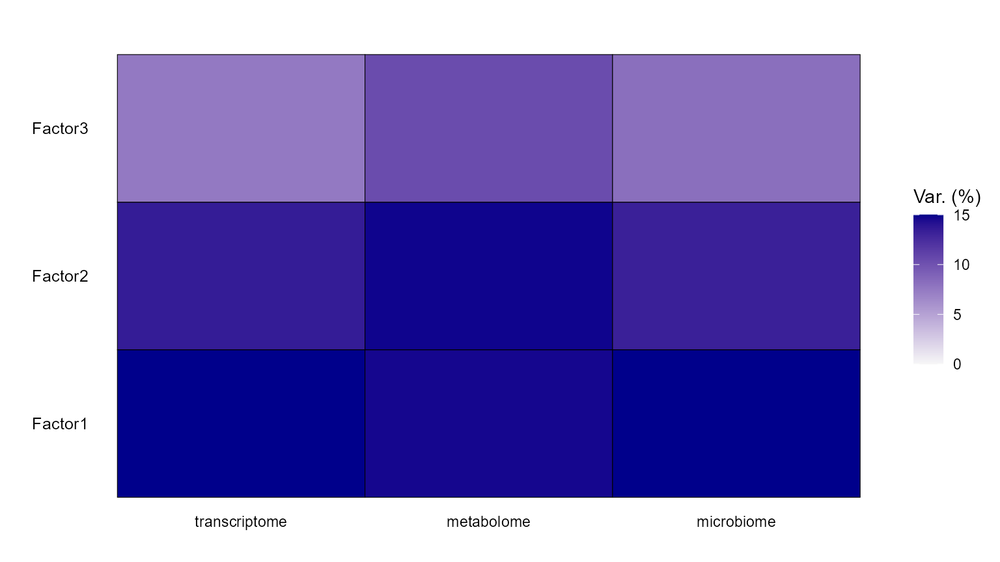
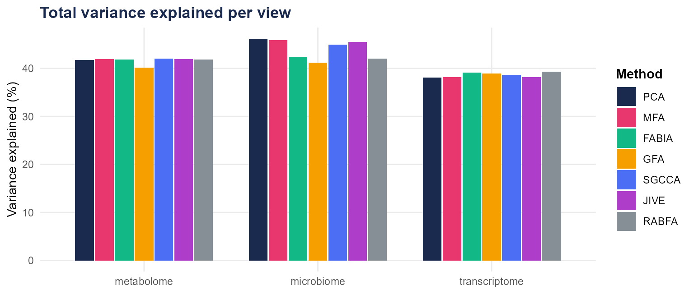

# Methods and how to tune them

``` r

library(factomics)
sim <- simulate_multiomics(n_samples = 60, seed = 1)
```

All methods are called the same way, through
`run_factor_pipeline(X, methods, k)`. Method-specific settings are
ordinary arguments with a method prefix (`fabia_*`, `mofa_*`, `gfa_*`,
`pca_*`, `sgcca_*`, `jive_*`).

``` r

knitr::kable(list_factor_methods()[, c("method", "package", "family",
                                      "description")])
```

| method | package | family | description |
|:---|:---|:---|:---|
| PCA | stats | Matrix factorisation | Block-weighted PCA on concatenated views |
| MFA | FactoMineR | Matrix factorisation | Multiple Factor Analysis (Escofier & Pages) |
| FABIA | fabia | Bayesian / biclustering | Factor Analysis for Bicluster Acquisition |
| GFA | GFA | Bayesian | Group Factor Analysis (Bayesian, view-specific sparsity) |
| MOFA | MOFA2 | Bayesian | Multi-Omics Factor Analysis v2 (needs Python mofapy2) |
| SGCCA | mixOmics | Correlation-based | Sparse Generalised Canonical Correlation Analysis |
| JIVE | r.jive | Matrix factorisation | Joint and Individual Variation Explained |
| RABFA | factomics | Bayesian / graph-guided | Graph-guided Bayesian FA with robust adaptive shrinkage (Zhang 2024) |

## Preprocessing shared by all methods

By default (`scale_features = TRUE`) every feature is z-scored, so all
features start on the same footing, and zero-variance features are set
to zero. Samples are aligned across views by name. If your data are
already normalised the way you want, use `scale_features = FALSE`.

## PCA: block-weighted, concatenated

The simplest integrative baseline: the views are stacked and a single
PCA is run. With `pca_block_weight = TRUE` (default) each view is
divided by the square root of its number of features, so a view with
10,000 genes does not swamp a view with 50 metabolites. It needs nothing
beyond base R.

``` r

res_pca <- run_factor_pipeline(sim$data, methods = "PCA", k = 4,
                               verbose = FALSE)
round(res_pca$PCA$meta$variance_percent, 1)
#> [1] 16.6 13.9  8.8  2.7
```

## MFA: Multiple Factor Analysis

MFA (FactoMineR) weights each view by its first eigenvalue, then runs a
global PCA. It is fast, deterministic and a strong default. It needs at
least two views. `mfa_group_sizes` can override the grouping of columns.

## FABIA

FABIA is a sparse, biclustering-oriented factor model: each factor is
driven by a small set of features and a subset of samples. `fabia_alpha`
controls loading sparseness (larger = sparser), `fabia_cyc` the number
of iterations.

``` r

res_fabia <- run_factor_pipeline(sim$data, methods = "FABIA", k = 4,
                                 fabia_alpha = 0.05, fabia_cyc = 500,
                                 verbose = FALSE)
```

## GFA: Group Factor Analysis

GFA is a Bayesian factor model with view-wise sparsity: each factor can
be active in all views, in some, or in only one. `gfa_iter_burnin` and
`gfa_iter_max` control the Gibbs sampler. More iterations give more
stable factors.

## MOFA2

MOFA2 is a Bayesian framework for multi-omics factor analysis that
handles missing values and different likelihoods. It runs in Python
(`mofapy2`) via reticulate. Either install `mofapy2` and tell factomics
where that Python is:

``` r

run_factor_pipeline(sim$data, methods = "MOFA", k = 4,
                    mofa_python = "/usr/bin/python3")
```

or let MOFA2 build its own Python environment with
`mofa_use_basilisk = TRUE`. The Docker image has everything set up
already. `mofa_convergence` (`"fast"`, `"medium"`, `"slow"`) trades
speed for precision.

``` r

res_mofa <- run_factor_pipeline(sim$data, methods = "MOFA", k = 4,
                                mofa_convergence = "fast", verbose = FALSE)
#> 
#>         #########################################################
#>         ###           __  __  ____  ______                    ### 
#>         ###          |  \/  |/ __ \|  ____/\    _             ### 
#>         ###          | \  / | |  | | |__ /  \ _| |_           ### 
#>         ###          | |\/| | |  | |  __/ /\ \_   _|          ###
#>         ###          | |  | | |__| | | / ____ \|_|            ###
#>         ###          |_|  |_|\____/|_|/_/    \_\              ###
#>         ###                                                   ### 
#>         ######################################################### 
#>          
#> 
#> 
#> use_float32 set to True: replacing float64 arrays by float32 arrays to speed up computations...
#> 
#> Scaling views to unit variance...
#> 
#> Successfully loaded view='transcriptome' group='group1' with N=60 samples and D=200 features...
#> Successfully loaded view='metabolome' group='group1' with N=60 samples and D=80 features...
#> Successfully loaded view='microbiome' group='group1' with N=60 samples and D=50 features...
#> 
#> 
#> Model options:
#> - Automatic Relevance Determination prior on the factors: False
#> - Automatic Relevance Determination prior on the weights: True
#> - Spike-and-slab prior on the factors: False
#> - Spike-and-slab prior on the weights: False
#> Likelihoods:
#> - View 0 (transcriptome): gaussian
#> - View 1 (metabolome): gaussian
#> - View 2 (microbiome): gaussian
#> 
#> 
#> 
#> 
#> ######################################
#> ## Training the model with seed 21 ##
#> ######################################
#> 
#> 
#> ELBO before training: -85258.96 
#> 
#> Iteration 1: time=0.01, ELBO=-28288.49, deltaELBO=56970.475 (66.82051012%), Factors=4
#> Iteration 2: time=0.00, Factors=4
#> Iteration 3: time=0.00, Factors=4
#> Iteration 4: time=0.00, Factors=4
#> Iteration 5: time=0.00, Factors=4
#> Iteration 6: time=0.00, ELBO=-24688.46, deltaELBO=3600.025 (4.22245920%), Factors=4
#> Iteration 7: time=0.00, Factors=4
#> Iteration 8: time=0.00, Factors=4
#> Iteration 9: time=0.00, Factors=4
#> Iteration 10: time=0.00, Factors=4
#> Iteration 11: time=0.00, ELBO=-24669.17, deltaELBO=19.295 (0.02263060%), Factors=4
#> Iteration 12: time=0.00, Factors=4
#> Iteration 13: time=0.00, Factors=4
#> Iteration 14: time=0.00, Factors=4
#> Iteration 15: time=0.00, Factors=4
#> Iteration 16: time=0.00, ELBO=-24656.99, deltaELBO=12.182 (0.01428835%), Factors=4
#> Iteration 17: time=0.00, Factors=4
#> Iteration 18: time=0.00, Factors=4
#> Iteration 19: time=0.00, Factors=4
#> Iteration 20: time=0.00, Factors=4
#> Iteration 21: time=0.00, ELBO=-24649.11, deltaELBO=7.881 (0.00924327%), Factors=4
#> Iteration 22: time=0.00, Factors=4
#> Iteration 23: time=0.00, Factors=4
#> Iteration 24: time=0.00, Factors=4
#> Iteration 25: time=0.00, Factors=4
#> Iteration 26: time=0.00, ELBO=-24643.68, deltaELBO=5.426 (0.00636403%), Factors=4
#> Iteration 27: time=0.00, Factors=4
#> Iteration 28: time=0.00, Factors=4
#> Iteration 29: time=0.00, Factors=4
#> Iteration 30: time=0.00, Factors=4
#> Iteration 31: time=0.00, ELBO=-24639.59, deltaELBO=4.096 (0.00480409%), Factors=4
#> Iteration 32: time=0.00, Factors=4
#> Iteration 33: time=0.00, Factors=4
#> Iteration 34: time=0.00, Factors=4
#> Iteration 35: time=0.00, Factors=4
#> Iteration 36: time=0.00, ELBO=-24636.18, deltaELBO=3.406 (0.00399537%), Factors=4
#> Iteration 37: time=0.00, Factors=4
#> Iteration 38: time=0.00, Factors=4
#> Iteration 39: time=0.00, Factors=4
#> Iteration 40: time=0.00, Factors=4
#> Iteration 41: time=0.00, ELBO=-24633.17, deltaELBO=3.010 (0.00353094%), Factors=4
#> Iteration 42: time=0.00, Factors=4
#> Iteration 43: time=0.00, Factors=4
#> Iteration 44: time=0.00, Factors=4
#> Iteration 45: time=0.00, Factors=4
#> Iteration 46: time=0.00, ELBO=-24630.46, deltaELBO=2.709 (0.00317771%), Factors=4
#> Iteration 47: time=0.00, Factors=4
#> Iteration 48: time=0.00, Factors=4
#> Iteration 49: time=0.00, Factors=4
#> Iteration 50: time=0.00, Factors=4
#> Iteration 51: time=0.00, ELBO=-24628.07, deltaELBO=2.392 (0.00280561%), Factors=4
#> Iteration 52: time=0.00, Factors=4
#> Iteration 53: time=0.00, Factors=4
#> Iteration 54: time=0.00, Factors=4
#> Iteration 55: time=0.00, Factors=4
#> Iteration 56: time=0.00, ELBO=-24625.99, deltaELBO=2.076 (0.00243516%), Factors=4
#> Iteration 57: time=0.00, Factors=4
#> Iteration 58: time=0.00, Factors=4
#> Iteration 59: time=0.00, Factors=4
#> Iteration 60: time=0.00, Factors=4
#> Iteration 61: time=0.00, ELBO=-24624.19, deltaELBO=1.806 (0.00211795%), Factors=4
#> Iteration 62: time=0.00, Factors=4
#> Iteration 63: time=0.00, Factors=4
#> Iteration 64: time=0.00, Factors=4
#> Iteration 65: time=0.00, Factors=4
#> Iteration 66: time=0.00, ELBO=-24622.59, deltaELBO=1.591 (0.00186627%), Factors=4
#> Iteration 67: time=0.00, Factors=4
#> Iteration 68: time=0.00, Factors=4
#> Iteration 69: time=0.00, Factors=4
#> Iteration 70: time=0.00, Factors=4
#> Iteration 71: time=0.00, ELBO=-24621.18, deltaELBO=1.418 (0.00166344%), Factors=4
#> Iteration 72: time=0.00, Factors=4
#> Iteration 73: time=0.00, Factors=4
#> Iteration 74: time=0.00, Factors=4
#> Iteration 75: time=0.00, Factors=4
#> Iteration 76: time=0.00, ELBO=-24619.89, deltaELBO=1.283 (0.00150535%), Factors=4
#> Iteration 77: time=0.00, Factors=4
#> Iteration 78: time=0.00, Factors=4
#> Iteration 79: time=0.00, Factors=4
#> Iteration 80: time=0.00, Factors=4
#> Iteration 81: time=0.00, ELBO=-24618.73, deltaELBO=1.163 (0.00136439%), Factors=4
#> Iteration 82: time=0.00, Factors=4
#> Iteration 83: time=0.00, Factors=4
#> Iteration 84: time=0.00, Factors=4
#> Iteration 85: time=0.00, Factors=4
#> Iteration 86: time=0.00, ELBO=-24617.66, deltaELBO=1.067 (0.00125196%), Factors=4
#> Iteration 87: time=0.00, Factors=4
#> Iteration 88: time=0.00, Factors=4
#> Iteration 89: time=0.00, Factors=4
#> Iteration 90: time=0.00, Factors=4
#> Iteration 91: time=0.00, ELBO=-24616.68, deltaELBO=0.979 (0.00114793%), Factors=4
#> Iteration 92: time=0.00, Factors=4
#> Iteration 93: time=0.00, Factors=4
#> Iteration 94: time=0.00, Factors=4
#> Iteration 95: time=0.00, Factors=4
#> Iteration 96: time=0.00, ELBO=-24615.78, deltaELBO=0.905 (0.00106163%), Factors=4
#> Iteration 97: time=0.00, Factors=4
#> Iteration 98: time=0.00, Factors=4
#> Iteration 99: time=0.00, Factors=4
#> Iteration 100: time=0.00, Factors=4
#> Iteration 101: time=0.00, ELBO=-24614.94, deltaELBO=0.837 (0.00098202%), Factors=4
#> Iteration 102: time=0.00, Factors=4
#> Iteration 103: time=0.00, Factors=4
#> Iteration 104: time=0.00, Factors=4
#> Iteration 105: time=0.00, Factors=4
#> Iteration 106: time=0.00, ELBO=-24614.16, deltaELBO=0.782 (0.00091721%), Factors=4
#> Iteration 107: time=0.00, Factors=4
#> Iteration 108: time=0.00, Factors=4
#> Iteration 109: time=0.00, Factors=4
#> Iteration 110: time=0.00, Factors=4
#> Iteration 111: time=0.00, ELBO=-24613.43, deltaELBO=0.729 (0.00085527%), Factors=4
#> Iteration 112: time=0.00, Factors=4
#> Iteration 113: time=0.00, Factors=4
#> Iteration 114: time=0.00, Factors=4
#> Iteration 115: time=0.00, Factors=4
#> Iteration 116: time=0.00, ELBO=-24612.75, deltaELBO=0.681 (0.00079877%), Factors=4
#> Iteration 117: time=0.00, Factors=4
#> Iteration 118: time=0.00, Factors=4
#> Iteration 119: time=0.00, Factors=4
#> Iteration 120: time=0.00, Factors=4
#> Iteration 121: time=0.00, ELBO=-24612.10, deltaELBO=0.646 (0.00075741%), Factors=4
#> Iteration 122: time=0.00, Factors=4
#> Iteration 123: time=0.00, Factors=4
#> Iteration 124: time=0.00, Factors=4
#> Iteration 125: time=0.00, Factors=4
#> Iteration 126: time=0.00, ELBO=-24611.49, deltaELBO=0.613 (0.00071873%), Factors=4
#> Iteration 127: time=0.00, Factors=4
#> Iteration 128: time=0.00, Factors=4
#> Iteration 129: time=0.00, Factors=4
#> Iteration 130: time=0.00, Factors=4
#> Iteration 131: time=0.00, ELBO=-24610.90, deltaELBO=0.589 (0.00069124%), Factors=4
#> Iteration 132: time=0.00, Factors=4
#> Iteration 133: time=0.00, Factors=4
#> Iteration 134: time=0.00, Factors=4
#> Iteration 135: time=0.00, Factors=4
#> Iteration 136: time=0.00, ELBO=-24610.32, deltaELBO=0.576 (0.00067585%), Factors=4
#> Iteration 137: time=0.00, Factors=4
#> Iteration 138: time=0.00, Factors=4
#> Iteration 139: time=0.00, Factors=4
#> Iteration 140: time=0.00, Factors=4
#> Iteration 141: time=0.00, ELBO=-24609.73, deltaELBO=0.591 (0.00069267%), Factors=4
#> Iteration 142: time=0.00, Factors=4
#> Iteration 143: time=0.00, Factors=4
#> Iteration 144: time=0.00, Factors=4
#> Iteration 145: time=0.00, Factors=4
#> Iteration 146: time=0.00, ELBO=-24609.06, deltaELBO=0.670 (0.00078584%), Factors=4
#> Iteration 147: time=0.00, Factors=4
#> Iteration 148: time=0.00, Factors=4
#> Iteration 149: time=0.00, Factors=4
#> Iteration 150: time=0.00, Factors=4
#> Iteration 151: time=0.00, ELBO=-24608.11, deltaELBO=0.952 (0.00111659%), Factors=4
#> Iteration 152: time=0.00, Factors=4
#> Iteration 153: time=0.00, Factors=4
#> Iteration 154: time=0.00, Factors=4
#> Iteration 155: time=0.00, Factors=4
#> Iteration 156: time=0.00, ELBO=-24606.24, deltaELBO=1.871 (0.00219403%), Factors=4
#> Iteration 157: time=0.00, Factors=4
#> Iteration 158: time=0.00, Factors=4
#> Iteration 159: time=0.00, Factors=4
#> Iteration 160: time=0.00, Factors=4
#> Iteration 161: time=0.00, ELBO=-24603.31, deltaELBO=2.927 (0.00343262%), Factors=4
#> Iteration 162: time=0.00, Factors=4
#> Iteration 163: time=0.00, Factors=4
#> Iteration 164: time=0.00, Factors=4
#> Iteration 165: time=0.00, Factors=4
#> Iteration 166: time=0.00, ELBO=-24601.39, deltaELBO=1.922 (0.00225473%), Factors=4
#> Iteration 167: time=0.00, Factors=4
#> Iteration 168: time=0.00, Factors=4
#> Iteration 169: time=0.00, Factors=4
#> Iteration 170: time=0.00, Factors=4
#> Iteration 171: time=0.00, ELBO=-24600.21, deltaELBO=1.184 (0.00138927%), Factors=4
#> Iteration 172: time=0.00, Factors=4
#> Iteration 173: time=0.00, Factors=4
#> Iteration 174: time=0.00, Factors=4
#> Iteration 175: time=0.00, Factors=4
#> Iteration 176: time=0.00, ELBO=-24599.34, deltaELBO=0.872 (0.00102255%), Factors=4
#> Iteration 177: time=0.00, Factors=4
#> Iteration 178: time=0.00, Factors=4
#> Iteration 179: time=0.00, Factors=4
#> Iteration 180: time=0.00, Factors=4
#> Iteration 181: time=0.00, ELBO=-24598.65, deltaELBO=0.683 (0.00080082%), Factors=4
#> Iteration 182: time=0.00, Factors=4
#> Iteration 183: time=0.00, Factors=4
#> Iteration 184: time=0.00, Factors=4
#> Iteration 185: time=0.00, Factors=4
#> Iteration 186: time=0.00, ELBO=-24598.09, deltaELBO=0.568 (0.00066592%), Factors=4
#> Iteration 187: time=0.00, Factors=4
#> Iteration 188: time=0.00, Factors=4
#> Iteration 189: time=0.00, Factors=4
#> Iteration 190: time=0.00, Factors=4
#> Iteration 191: time=0.01, ELBO=-24597.60, deltaELBO=0.490 (0.00057448%), Factors=4
#> Iteration 192: time=0.00, Factors=4
#> Iteration 193: time=0.00, Factors=4
#> Iteration 194: time=0.00, Factors=4
#> Iteration 195: time=0.00, Factors=4
#> Iteration 196: time=0.00, ELBO=-24597.17, deltaELBO=0.429 (0.00050283%), Factors=4
#> Iteration 197: time=0.00, Factors=4
#> Iteration 198: time=0.00, Factors=4
#> Iteration 199: time=0.00, Factors=4
#> Iteration 200: time=0.00, Factors=4
#> Iteration 201: time=0.00, ELBO=-24596.78, deltaELBO=0.389 (0.00045569%), Factors=4
#> Iteration 202: time=0.00, Factors=4
#> Iteration 203: time=0.00, Factors=4
#> Iteration 204: time=0.00, Factors=4
#> Iteration 205: time=0.00, Factors=4
#> Iteration 206: time=0.00, ELBO=-24596.43, deltaELBO=0.348 (0.00040855%), Factors=4
#> 
#> Converged!
#> 
#> 
#> 
#> #######################
#> ## Training finished ##
#> #######################
#> 
#> 
#> Saving model in C:\Users\hp\AppData\Local\Temp\RtmpM99ZUH/mofa_model.hdf5...
res_mofa$MOFA$plots$variance_by_factor
```



## SGCCA: sparse generalised CCA

SGCCA (mixOmics) finds components that maximise the covariance between
views, one component per view and dimension; factomics reports their
average as the sample score. By default all features are kept;
`sgcca_keep` gives the number of features to keep per view and
component, for sparse, more interpretable loadings.

``` r

res_sgcca <- run_factor_pipeline(sim$data, methods = "SGCCA", k = 3,
                                 sgcca_keep = c(30, 15, 10), verbose = FALSE)
colSums(res_sgcca$SGCCA$loadings != 0)
#> F1 F2 F3 
#> 55 55 55
```

## JIVE

JIVE splits each view into a **joint** part shared by all views (rank
`k`), an **individual** part specific to the view (rank
`jive_rank_individual`) and noise. factomics reports the factors of the
joint part; the individual parts are kept in `meta$individual`.

``` r

res_jive <- run_factor_pipeline(sim$data, methods = "JIVE", k = 3,
                                jive_rank_individual = 1, verbose = FALSE)
```

## RABFA: graph-guided Bayesian factor analysis

RABFA (Zhang, Chang, Shen and Long, 2024, *Biometrics*) is a Bayesian
factor model that uses prior knowledge of which features act together,
typically a pathway graph such as KEGG, to guide which loadings are
shrunk to zero:

- every loading has its own Laplace shrinkage parameter, so strong
  signals are shrunk little and noise a lot (**adaptive shrinkage**);
- the log shrinkage parameters of features that are connected in the
  graph are correlated through a sparse precision matrix that is itself
  learnt from the data, so connected features tend to be selected
  together, while edges that disagree with the data are down-weighted
  (**robust to wrong edges**).

factomics implements the Gaussian version of the model with a Gibbs
sampler (Metropolis-Hastings for the shrinkage parameters, block Gibbs
for the graph precision matrix), written from the published model.

The graph is a data frame of edges with columns `from` and `to`, an
adjacency matrix, or one adjacency matrix per view. Feature names may be
plain (`TP53`) or view-prefixed (`rna::TP53`); edges between different
views are ignored, as in the paper. Here we build the graph that the
simulation actually used, by connecting the features loaded on the same
true factor:

``` r

W <- sim$truth$W
pathways <- do.call(rbind, lapply(names(W), function(v)
  do.call(rbind, lapply(seq_len(ncol(W[[v]])), function(f) {
    on <- rownames(W[[v]])[W[[v]][, f] != 0]
    data.frame(from = on[1], to = on[-1], view = v)   # star-shaped pathway
  }))))
edges <- data.frame(from = paste0(pathways$view, "::", pathways$from),
                    to   = paste0(pathways$view, "::", pathways$to))
head(edges, 3)
#>                      from                      to
#> 1 transcriptome::gene_001 transcriptome::gene_002
#> 2 transcriptome::gene_001 transcriptome::gene_015
#> 3 transcriptome::gene_001 transcriptome::gene_035
```

``` r

res_rabfa <- run_factor_pipeline(sim$data, methods = "RABFA", k = 4,
                                 rabfa_graph = edges,
                                 rabfa_iter = 1500, rabfa_burnin = 750,
                                 verbose = FALSE)
res_rabfa$RABFA$meta$n_edges
#> [1] 181
```

The result has the usual `scores` and `loadings` (posterior means) and,
in `meta`, the loadings whose 95% credible interval excludes zero, the
posterior shrinkage parameters, a BIC-type criterion, and the
log-likelihood trace for checking convergence:

``` r

m <- res_rabfa$RABFA$meta
colSums(m$selected)
#> F1 F2 F3 F4 
#> 66 62 62  0
plot(m$loglik_trace, type = "l", xlab = "Iteration", ylab = "Log-likelihood",
     main = "RABFA trace (burn-in = first half)")
```


How well do the selected loadings match the true signal features?

``` r

truth <- sim$truth$feature_labels[rownames(m$selected)]
table(selected = rowSums(m$selected) > 0, true_signal = truth)
#>         true_signal
#> selected   0   1
#>    FALSE 163   7
#>    TRUE    4 156
```

Without pathway knowledge,
[`build_feature_graph()`](https://lucp12891.github.io/factomics/reference/build_feature_graph.md)
gives a data-driven graph (features in the same view with high
correlation), and
[`rabfa()`](https://lucp12891.github.io/factomics/reference/rabfa.md) is
a shortcut:

``` r

g   <- build_feature_graph(sim$data, cutoff = 0.5, max_neighbors = 5)
fit <- rabfa(sim$data, k = 4, graph = g, iter = 5000, burnin = 2500)
```

The main tuning parameters
([`rabfa_control()`](https://lucp12891.github.io/factomics/reference/rabfa_control.md))
are `nu1` (overall shrinkage; larger is sparser) and `nu2` (how adaptive
each loading’s shrinkage is); the paper chose them, and `k`, by grid
search on the BIC stored in `meta$bic`. `eta = 10` and `eps = 0.2`
follow the paper. MCMC needs enough iterations: the paper used
5,000-10,000; check `loglik_trace` has flattened after burn-in.

## Running many methods together

If a method fails (missing package, too few views, numerical problem) it
is skipped with a warning and the others are still returned. Use
`stop_on_error = TRUE` to make failures fatal instead.

``` r

res_all <- run_factor_pipeline(
  sim$data, methods = c("PCA", "MFA", "FABIA", "GFA", "SGCCA", "JIVE",
                       "RABFA"),
  k = 4, rabfa_graph = edges, rabfa_iter = 1000, rabfa_burnin = 500,
  verbose = FALSE)
res_all
#> <factomics_results>
#>   60 samples, 3 view(s): transcriptome (200), metabolome (80), microbiome (50)
#>   PCA    4 factors
#>   MFA    4 factors
#>   FABIA  4 factors
#>   GFA    4 factors
#>   SGCCA  4 factors
#>   JIVE   4 factors
#>   RABFA  4 factors
```

``` r

plot_variance_explained(res_all, type = "total")
```



## Choosing the number of factors

There is no single right `k`. A practical approach is to fit a generous
`k`, look at
[`plot_variance_explained()`](https://lucp12891.github.io/factomics/reference/plot_variance_explained.md),
and keep the factors that explain a noticeable share of variance in at
least one view, or that associate with covariates of interest
([`plot_factor_associations()`](https://lucp12891.github.io/factomics/reference/plot_factor_associations.md)).
