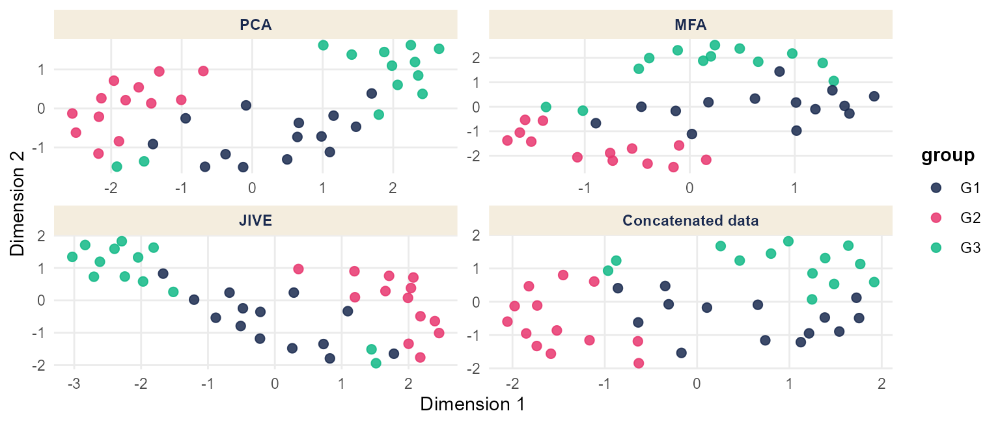

# Using your own data

## The input format

factomics needs **a named list of numeric matrices, one per omics layer,
with features in rows and samples in columns**. Column names are sample
IDs and must be the same set in every matrix (the order may differ;
factomics aligns them). Row names are feature IDs.

    X <- list(
      transcriptome = <genes x samples matrix>,
      metabolome    = <metabolites x samples matrix>,
      microbiome    = <taxa x samples matrix>
    )

Metadata is a data frame with one row per sample and a column holding
the sample IDs (`"sample"` by default; set `sample_col` otherwise).

## Reading CSV or Excel files

If each file has feature IDs in the first column and one column per
sample:

``` r

read_view <- function(path) as.matrix(read.csv(path, row.names = 1,
                                               check.names = FALSE))
X <- list(
  rna = read_view("data/rna_counts_normalised.csv"),
  met = read_view("data/metabolites.csv")
)
meta <- read.csv("data/metadata.csv")
```

For Excel files,
[`readxl::read_excel()`](https://readxl.tidyverse.org/reference/read_excel.html)
gives a data frame; move the first column to the row names before
[`as.matrix()`](https://rdrr.io/r/base/matrix.html):

``` r

read_xlsx_view <- function(path, sheet = 1) {
  df <- as.data.frame(readxl::read_excel(path, sheet = sheet))
  rownames(df) <- df[[1]]
  as.matrix(df[, -1])
}
```

If your files are **samples x features** instead, transpose with
[`t()`](https://rdrr.io/r/base/t.html).

## Keeping only shared samples

``` r

common <- Reduce(intersect, lapply(X, colnames))
X <- lapply(X, function(m) m[, common])
```

## Preprocessing advice

factomics z-scores each feature by default (`scale_features = TRUE`).
What it does **not** do is the omics-specific normalisation, which you
should apply first:

| Data type | Typical preparation |
|----|----|
| RNA-seq counts | library-size normalisation and a log or variance-stabilising transform (e.g. [`DESeq2::vst()`](https://rdrr.io/pkg/DESeq2/man/vst.html)) |
| Microbiome counts | filter rare taxa, then a centred log-ratio (CLR) transform |
| Metabolomics / lipidomics | log transform, impute or drop features with many missing values |
| Methylation | M-values rather than beta values |

Also consider keeping only the most variable features per view (for
example the top 2,000 genes), which speeds every method up and removes
noise:

``` r

top_var <- function(m, n) m[order(-apply(m, 1, var))[seq_len(min(n, nrow(m)))], ]
X$rna <- top_var(X$rna, 2000)
```

Missing values are set to zero after scaling (that is, to the feature
mean). MOFA2 can model missing values natively; for the other methods,
impute or remove heavily missing features beforehand.

## A worked example with files

To show the whole route, we write simulated data to CSV files, read them
back and analyse them:

``` r

library(factomics)
sim <- simulate_multiomics(n_samples = 40, seed = 2)
dir <- tempfile("mydata"); dir.create(dir)
for (v in names(sim$data))
  write.csv(sim$data[[v]], file.path(dir, paste0(v, ".csv")))
write.csv(sim$metadata, file.path(dir, "metadata.csv"), row.names = FALSE)

files <- list.files(dir, pattern = "csv$", full.names = TRUE)
files <- files[basename(files) != "metadata.csv"]
X <- lapply(setNames(files, sub("\\.csv$", "", basename(files))),
            function(f) as.matrix(read.csv(f, row.names = 1,
                                           check.names = FALSE)))
meta <- read.csv(file.path(dir, "metadata.csv"))

fx <- factomics(X, metadata = meta, methods = c("PCA", "MFA", "JIVE"), k = 3,
                embeddings = "umap", verbose = FALSE)
fx
#> <factomics workflow>
#> <factomics_results>
#>   40 samples, 3 view(s): metabolome (80), microbiome (50), transcriptome (200)
#>   PCA       3 factors
#>   MFA       3 factors
#>   JIVE      3 factors
#>   Embeddings: UMAP 
#>   Clustering:
#>             method algorithm k silhouette
#>                PCA    kmeans 4      0.367
#>                MFA    kmeans 4      0.368
#>               JIVE    kmeans 4      0.366
#>  Concatenated data    kmeans 2      0.111
#>   Benchmark (mean |r| of matched factor scores):
#>         pair mean_abs_corr_scores
#>   PCA vs MFA                1.000
#>  PCA vs JIVE                0.999
#>  MFA vs JIVE                0.999
```

``` r

plot_embedding(fx$embeddings, meta, color_by = "group")
```



Save everything as CSV tables:

``` r

out <- export_results(fx, file.path(dir, "results"))
basename(out)
#>  [1] "PCA_scores.csv"         "PCA_loadings.csv"       "MFA_scores.csv"        
#>  [4] "MFA_loadings.csv"       "JIVE_scores.csv"        "JIVE_loadings.csv"     
#>  [7] "variance_explained.csv" "clusters.csv"           "cluster_summary.csv"   
#> [10] "embeddings.csv"         "benchmark_scores.csv"
```
