# Embeddings and visualisation: PCA, UMAP, t-SNE

``` r

library(factomics)
sim <- simulate_multiomics(n_samples = 60, seed = 1)
res <- run_factor_pipeline(sim$data, methods = c("PCA", "MFA", "GFA", "JIVE"),
                           k = 4, verbose = FALSE)
```

## Factor scores directly

The most direct view of a factor model: plot one factor against another.

``` r

plot_factor_scores(res, factors = c(1, 2), metadata = sim$metadata,
                   color_by = "group")
```

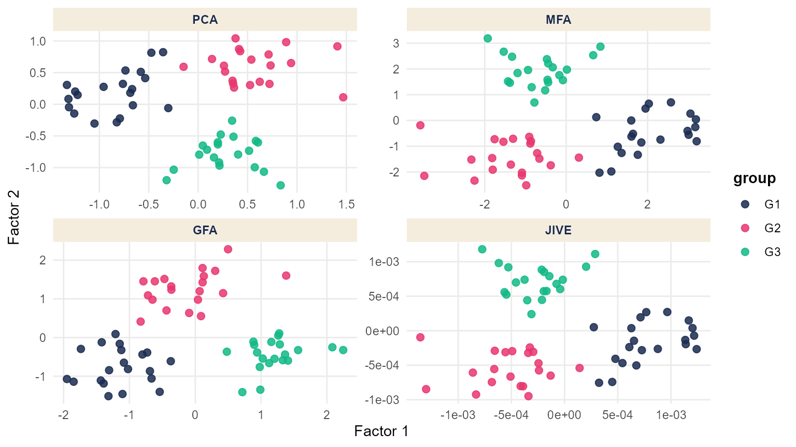

## PCA, UMAP and t-SNE of the factor space

With more than two factors, a 2-D embedding shows the whole factor space
at once.
[`embed_results()`](https://lucp12891.github.io/factomics/reference/embed_results.md)
embeds the scores of every method, plus the concatenated input data as a
baseline, with any of the three techniques:

``` r

emb <- embed_results(res, type = c("pca", "umap", "tsne"))
plot_embedding(emb, metadata = sim$metadata, color_by = "group")
```

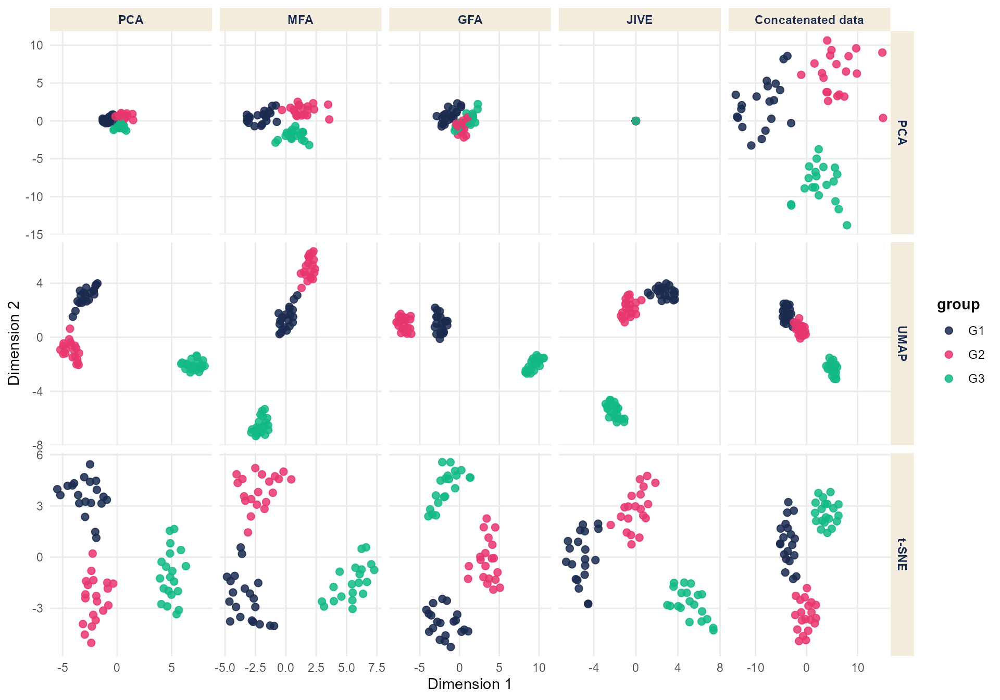

Points can also be shaped by a second variable:

``` r

emb_umap <- embed_results(res, type = "umap")
plot_embedding(emb_umap, metadata = sim$metadata, color_by = "group",
               shape_by = "batch")
```

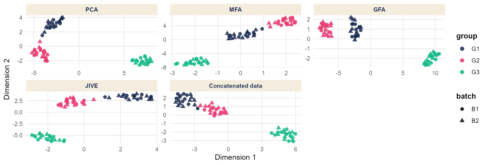

The defaults are chosen for the small sample sizes common in omics: UMAP
uses `n_neighbors = min(15, n - 1)` and t-SNE a perplexity below
`(n - 1) / 3`. Both can be changed, and
[`compute_embedding()`](https://lucp12891.github.io/factomics/reference/compute_embedding.md)
works on any samples x features matrix:

``` r

e <- compute_embedding(res$MFA$scores, type = "umap", n_neighbors = 10,
                       min_dist = 0.3)
head(e, 3)
#>   sample      Dim1      Dim2
#> 1   S001 -5.262751 -1.082647
#> 2   S002 -4.685367 -4.324579
#> 3   S003  8.827639  2.806306
```

## Variance explained

``` r

plot_variance_explained(res)
```

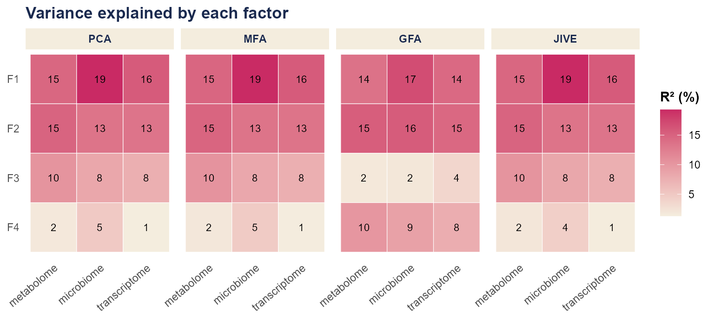

``` r

plot_variance_explained(res, type = "total")
```

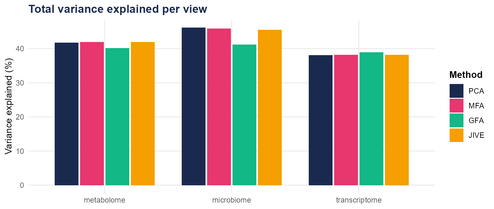

The underlying numbers are available as a table:

``` r

ve <- variance_explained(res)
head(ve[ve$factor == "Total", ])
#>    method          view factor        R2
#> 5     PCA transcriptome  Total 0.3811597
#> 10    PCA    metabolome  Total 0.4174590
#> 15    PCA    microbiome  Total 0.4618156
#> 20    MFA transcriptome  Total 0.3820345
#> 25    MFA    metabolome  Total 0.4195281
#> 30    MFA    microbiome  Total 0.4585480
```

## Heatmap of factor scores

``` r

plot_factor_heatmap(res, "MFA", metadata = sim$metadata, order_by = "group")
```

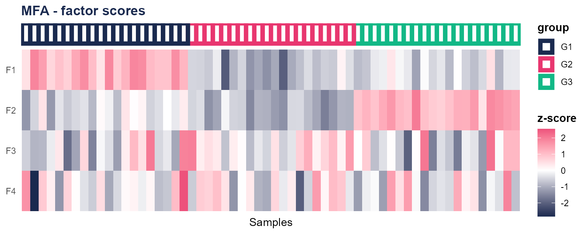

## Top features of a factor

``` r

plot_top_loadings(res, "GFA", factor = 1, n = 25)
```

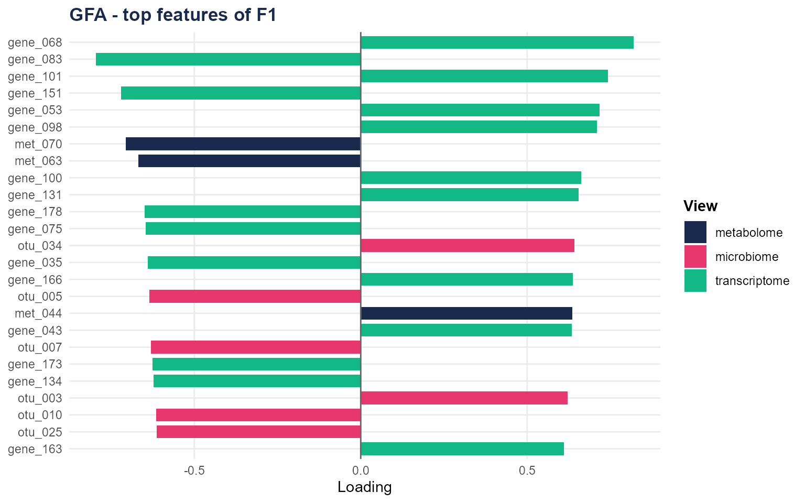

Restrict to one view:

``` r

plot_top_loadings(res, "GFA", factor = 1, n = 15, view = "metabolome")
```

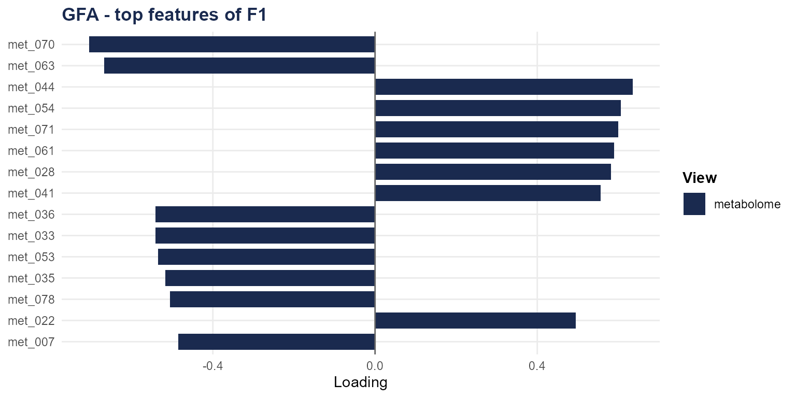

## Factors and covariates

``` r

plot_factor_associations(res, sim$metadata, covariates = c("group", "batch",
                                                          "age"))
```

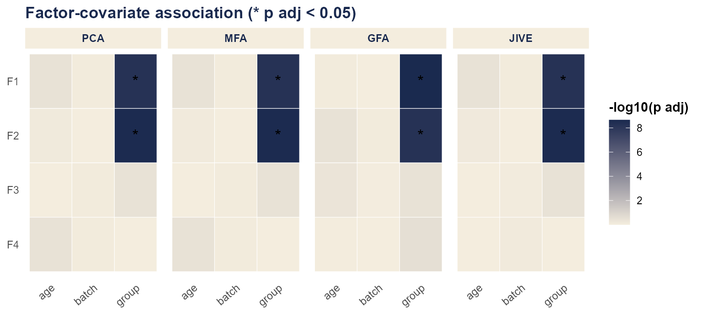

## Comparing one factor across methods

[`plot_scores_scatter_grid()`](https://lucp12891.github.io/factomics/reference/plot_scores_scatter_grid.md)
and
[`plot_scores_lollipop_grid()`](https://lucp12891.github.io/factomics/reference/plot_scores_lollipop_grid.md)
show one factor per method, side by side. Each method’s factor is
matched to the reference method’s factor (by largest absolute
correlation) and its sign aligned.

``` r

res <- attach_scores_metadata(res, sim$metadata)
plot_scores_scatter_grid(res, factor_idx = 1, group_col = "group",
                         align_to = "MFA")
```

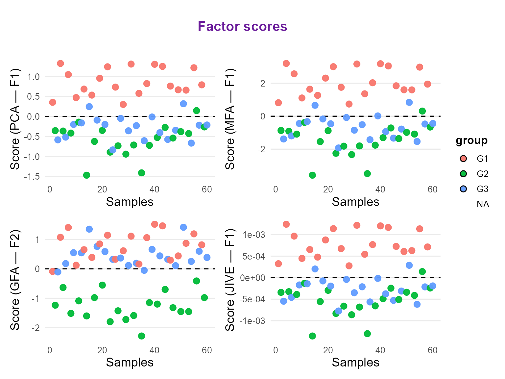

``` r

plot_scores_lollipop_grid(res, factor_idx = 1, group_col = "group",
                          baseline = "group_mean", align_to = "MFA")
```

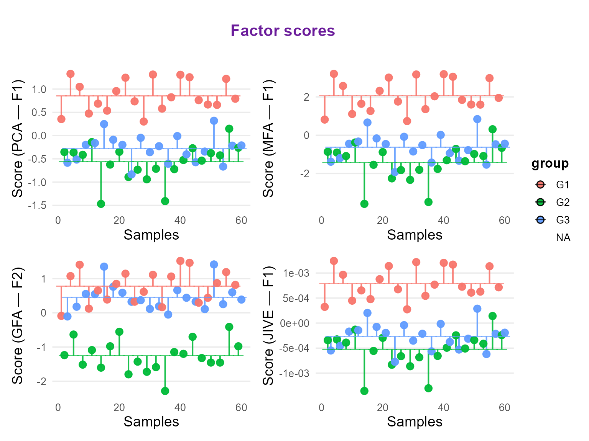

## Theming

All plots are ggplot2 objects and use
[`theme_factomics()`](https://lucp12891.github.io/factomics/reference/theme_factomics.md);
add or override layers as usual:

``` r

plot_embedding(emb_umap, sim$metadata, color_by = "group") +
  ggplot2::theme_classic()
```
