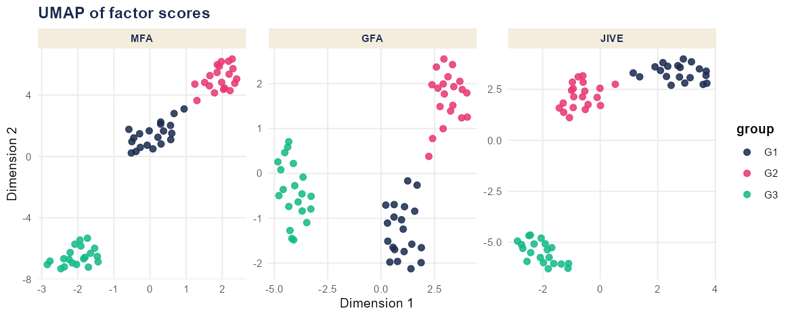
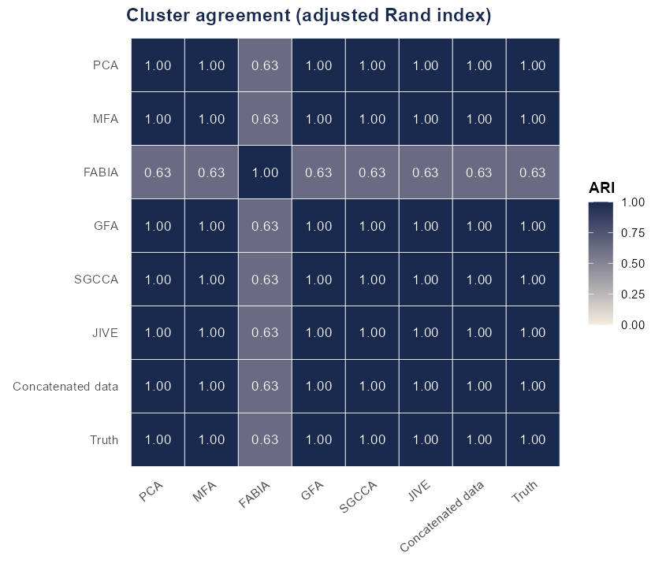

# factomics


One toolbox for multi-omics factor analysis in R. Eight factor methods
behind one function, one result format, and the whole downstream
workflow: embeddings, clustering, benchmarking and interpretation. Also
available as a ready-to-run Docker image.

[Get
started](https://lucp12891.github.io/factomics/articles/factomics.md)
[Methods](https://lucp12891.github.io/factomics/articles/methods.md)
[Docker](https://lucp12891.github.io/factomics/articles/docker.md)
[Reference](https://lucp12891.github.io/factomics/reference/index.md)
[GitHub](https://github.com/lucp12891/factomics)

## Why factomics

Multi-omics studies measure the same samples through several layers
(transcriptome, metabolome, microbiome, …). Latent factor methods
summarise these layers into a few shared factors, but each method lives
in its own package, with its own input format, output format and quirks.
**factomics** gives them **one input** (a named list of *features x
samples* matrices) and **one output** (`scores`, `loadings`, `meta` per
method), so that every downstream function works with every method and
methods can be compared side by side.

### Matrix factorisation

Block-weighted PCA, Multiple Factor Analysis and JIVE. `PCA`, `MFA`,
`JIVE`.

### Bayesian factor models

Sparse, view-aware factors with automatic relevance. `MOFA`, `GFA`,
`FABIA`.

### Graph-guided

Pathway knowledge guides the loadings, robust to wrong edges. `RABFA`
(Zhang et al. 2024).

### Correlation-based

Components that maximise covariance between views. `SGCCA`.

### Embeddings

PCA, UMAP and t-SNE of each method’s factor space.
[`embed_results()`](https://lucp12891.github.io/factomics/reference/embed_results.md).

### Clustering

k-means, hierarchical or PAM, with k chosen by silhouette.
[`cluster_results()`](https://lucp12891.github.io/factomics/reference/cluster_results.md).

### Benchmark and interpret

Factor matching, variance explained, top features and covariate tests.
[`benchmark_factor_methods()`](https://lucp12891.github.io/factomics/reference/benchmark_factor_methods.md).

## See it in action

Every figure below comes from the simulated example data, in a few lines
of factomics.



UMAP of each method’s factors


Variance explained per factor and view



Cluster agreement across methods


Choosing the number of clusters


Benchmark: factor correlation across methods


Which factors track the covariates

## 60-second quick start

``` r

# install.packages("remotes")
remotes::install_github("lucp12891/factomics")

library(factomics)
sim <- simulate_multiomics(n_samples = 60, seed = 1)   # or a list of your own matrices

fx <- factomics(sim$data, metadata = sim$metadata,
                methods = c("PCA", "MFA", "FABIA", "GFA", "SGCCA", "JIVE"),
                k = 4, embeddings = c("umap", "tsne"))

plot_embedding(fx$embeddings, sim$metadata, color_by = "group")
plot_variance_explained(fx$results)
plot_clusters(fx$clusters, "agreement")
```

Or, with nothing installed but Docker:

``` bash
docker run --rm -v "$PWD":/work ghcr.io/lucp12891/factomics:latest \
  factomics-cli --demo --out output
```

## Where to next

- [Get
  started](https://lucp12891.github.io/factomics/articles/factomics.md):
  the full workflow on simulated data.
- [Methods](https://lucp12891.github.io/factomics/articles/methods.md):
  what each method does, and how to run and tune it.
- [Embeddings and
  visualisation](https://lucp12891.github.io/factomics/articles/visualization.md):
  PCA, UMAP, t-SNE, heatmaps, loadings.
- [Clustering](https://lucp12891.github.io/factomics/articles/clustering.md):
  finding sample subgroups from the factors.
- [Benchmarking
  methods](https://lucp12891.github.io/factomics/articles/benchmarking.md):
  do the methods agree, and which recovers the truth?
- [Your own
  data](https://lucp12891.github.io/factomics/articles/own-data.md):
  reading files, preprocessing and metadata.
- [Docker and command
  line](https://lucp12891.github.io/factomics/articles/docker.md): the
  container and `factomics-cli`.
